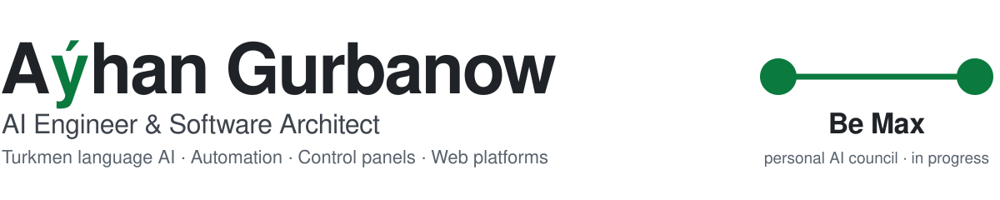

<picture>
  <source media="(prefers-color-scheme: dark)" srcset="assets/header-dark.svg">
  
</picture>

 

I design and build software that companies run on: **automation, control and admin panels, web platforms**, and the **AI systems** behind them.
Most of my time now goes into **Turkmen language AI**. I'm training a Turkmen LLM, building an OCR engine for Turkmen texts, and bringing both into **Be Max**, the personal AI system I'm building.

### Be Max

My flagship project: a personal AI council that runs on a small server at home. It is **local-first and privacy-first**. It recognizes each person in the house and keeps a separate profile and memory for each of them. Requests are routed to one of three rooms:

- **Council room**: an idea goes through four roles in order (critic, alternatives, implementer, decision maker) and comes back as a decision, a staged plan, the conflicts found and the questions still open.
- **Task room**: a request becomes a safe plan. Nothing runs until the user approves it, and every tool call is permissioned and logged.
- **Daily room**: an everyday assistant that knows your style and helps with routine things.

The Turkmen LLM below is being trained to be Be Max's Turkmen voice: the bridge between the people at home and the agents inside.

Python · FastAPI · LangGraph · local models via Ollama. In active development; source code is private.

### What I do

- **AI systems**: LLM training and fine-tuning (CPT · SFT · DPO), RAG, OCR, voice and home assistants
- **Business automation**: workflow automation, control panels, admin and reporting dashboards
- **Web platforms**: full-stack apps from database to UI, built for real day-to-day use
- **Architecture & leadership**: system and project architecture; leading a software team
- **Security**: server hardening, access control, secure on-premise deployments

### Tech

<picture>
  <source media="(prefers-color-scheme: dark)" srcset="assets/tech-dark.svg">
  
</picture>

Also: SQL Server · T-SQL · PostgREST · Hugging Face · Unsloth · FastAPI

### Featured work

| Project | What it is | Status |
|---|---|---|
| **Turkmen LLM** | Language model adapted to Turkmen: custom tokenizer, a multi-billion-token corpus, CPT → SFT → DPO pipeline | In progress |
| **Turkmen OCR** | Own CRNN-based OCR for Turkmen print; ~96% word-level agreement with a commercial OCR reference | In progress |
| **[PlateView](https://github.com/ayhan-gurbanow/3d_menu)** | In-restaurant 3D/AR menu with tablet ordering, staff dashboard and reports. Next.js, PostgreSQL | Active |

<b>Türkmençe</b>

 

**Programma üpjünçiligi inženeri we emeli aň boýunça hünärmen.**

Kärhanalar üçin programma üpjünçiligini taslaýaryn we döredýärin: iş proseslerini awtomatlaşdyrmak, dolandyryş we hasabat panelleri, web platformalar hem-de olaryň aňyrsyndaky emeli aň ulgamlary.

Esasy ünsümi türkmen dili üçin emeli aň tehnologiýalaryna gönükdirýärin: türkmen dilinde işleýän uly dil modelini (LLM) öwretmek, türkmen tekstleri üçin OCR ulgamyny döretmek we bu tehnologiýalary gündelik işde we durmuşda ulanylýan akylly kömekçilere öwürmek.

Hyzmatdaşlyk ýa-da taslama boýunça e-poçta arkaly habarlaşyp bilersiňiz.

### Contact

[gurbanowayhan05@gmail.com](mailto:gurbanowayhan05@gmail.com) · Türkmenistan

Open to automation, AI and software architecture projects.
